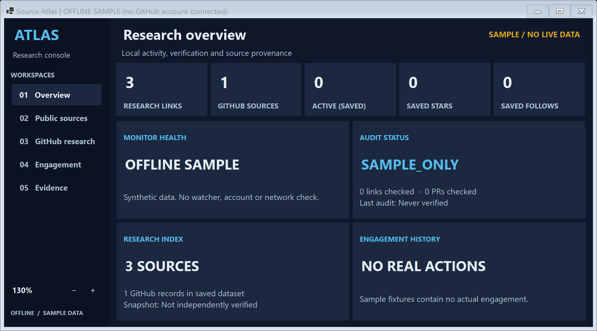
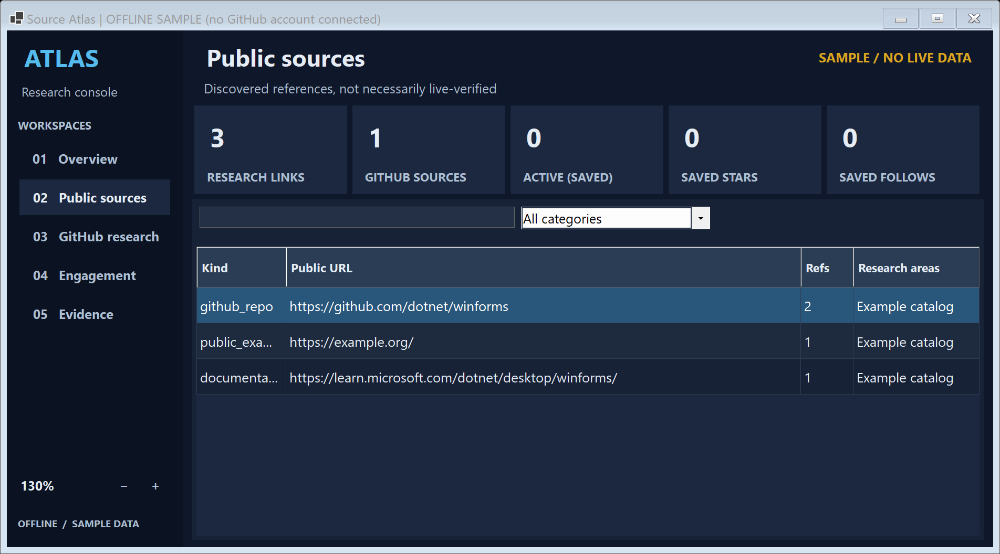
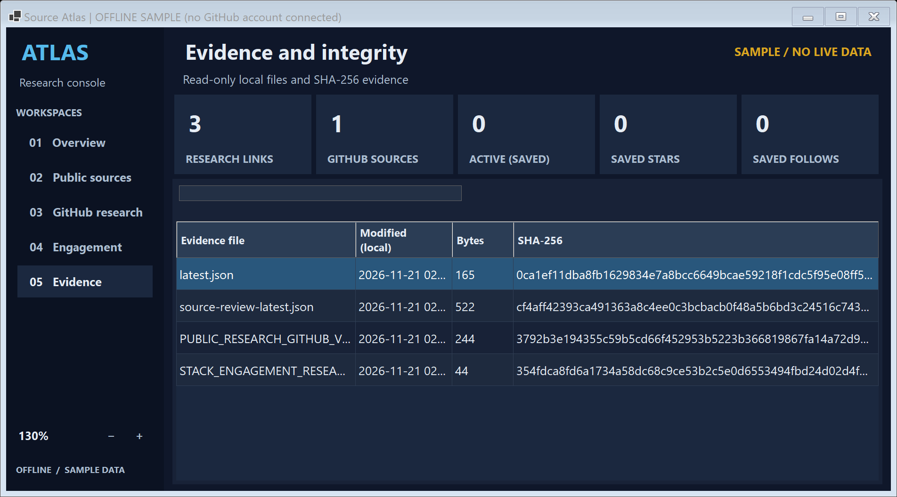

# Source Atlas

**Native Windows research monitor and GitHub publishing evidence viewer.**

Source Atlas helps turn approved local research files, public references, and GitHub project receipts into an inspectable desktop workflow. It runs in a Windows user session, not in ChatGPT scheduled tasks or another cloud service.

**Status:** Public source preview, v0.1.0. The offline demo is self-contained. Live monitoring requires a separately configured owner-controlled audit bundle. No downloadable production installer or generally supported release is claimed.

## Try the offline demo

Requirements: Windows with the [.NET 10 SDK](https://dotnet.microsoft.com/en-us/download/dotnet/10.0).

~~~powershell
git clone https://github.com/ihatesirdavi/source-atlas.git
cd source-atlas
dotnet restore .\SourceAtlas.csproj
dotnet run --project .\SourceAtlas.csproj --configuration Release -- --demo
~~~

This opens an offline, read-only catalog from bundled sample-data. It does **not** authenticate to GitHub, scan private notes, perform social actions, or check live GitHub status. The sample counts and verification statuses are labeled SAMPLE_ONLY and SAMPLE_NOT_VERIFIED.

## Television workspace candidate

This unmerged draft reworks the existing WinForms shell for real 50-inch TCL usage at 1920 x 1080 and 200% Windows DPI. It has a persistent left workspace rail, overview status cards, enlarged filterable research/GitHub grids, a searchable evidence hash table and bounded text zoom. The underlying local audit collector and profile permissions do not change.

**Physical-screen QA:** the isolated QA mode targets the real TCL 50S421 display geometry and DPI. Native tests exercise sidebar page switching, zoom controls and evidence layout. Each capture receipt identifies its method: `physical.CopyFromScreen` only when Source Atlas owns the foreground, or `window.PrintWindow.not_physical_screen` for a window-specific capture when another application covers the display. A window-only capture does **not** prove the candidate was unobstructed on the physical screen. Private research screenshots stay local; synthetic demo images are published here.

To validate 50-inch physical layout in an authorized local workstation, use the QA-only flags --qa-physical and --qa-dir together with --role main-tv, --data and the approved --resolver. This path collects screenshots and then exits. It is not allowed to start a second live monitor on the primary TV. Physical acceptance does not imply a signed installer or a generally available production release.
## Desktop features

- Five searchable panes: overview, public research references, GitHub repository snapshots, prior engagement receipts, and evidence hashes.
- User-adjustable text size with A− and A+ controls, bounded zoom and saved local zoom preferences.
- Native WinForms on .NET 10, with tested 130% and 150% display layouts and a separate high-DPI offline demo test.
- A resident local monitor that watches only approved source directories, coalesces changes, performs bounded read-only checks, and writes a local heartbeat.
- Tray controls for opening the window, checking again, pausing/resuming, and exiting; a second launcher activates an existing instance.
- No autonomous GitHub stars, follows, forks, reactions, merges, releases, or publishing actions.

## Configured live mode

**Live mode is not a turnkey public installer.** It currently assumes an owner-controlled Windows environment with:

1. A separately installed, SHA-256-verified local Python audit bundle and Windows Python runtime.
2. An approved private data directory with audit receipts and a bounded research-source root configuration.
3. A display-role resolver supplied by the workstation. The current integration recognizes the designated LG or TCL role; generic multimonitor autodiscovery is not implemented.
4. An authorized profile/research checkout.

Example invocation (replace placeholders with approved local paths):

~~~powershell
.\bin\Release\net10.0-windows\SourceAtlas.exe --data "<private-receipts-directory>" --resolver "<approved-display-resolver.ps1>" --role agent-tv --root "<authorized-profile-checkout>"
~~~

An optional --start-hidden flag starts in the system tray. Monitor state exists only while that Windows user session is running. For `--start-hidden` only, initial display-role discovery allows three additional fail-closed attempts (5, 10 and 15 seconds between attempts) if Windows monitor enumeration is temporarily unavailable at logon. It never guesses another physical display, moves a window, starts another service or grants deployment authority; it can still exit if the correct role is not identified. An optional --ui-scale 1.50 changes the starting font zoom, while A− and A+ save the user's choice locally.

The repository intentionally **does not** ship real notes, private file lists, authentication details, installed audit scripts, user-machine startup shortcuts, or confidential evidence. The sample-data schema is useful for offline UI exploration; it does not authorize reading private research.

## Read-only post-restart resident check

A previous `source-atlas-live-state.json` can say `WATCHING` even when that old PID no longer exists. Neither its saved text nor a prior audit `PASS` establishes restart recovery. The source-only diagnostic checks timestamp freshness, PID lifetime, expected process name and the current Windows session **without starting or stopping any resident process**:

~~~powershell
dotnet .\bin\Release\net10.0-windows\SourceAtlas.dll --check-live --data "<approved-private-receipts-directory>" --evidence "<new-private-report-file>.json"
~~~

The JSON evidence uses `source-atlas-resident-check-v1`. Exit `0` means `PROCESS_CONFIRMED` (process identity only, **not** authenticated audit/heartbeat health); exit `3` means missing, invalid, stale, time-inconsistent or unverified process state; exit `2` means invalid input/evidence write. Evidence uses create-new semantics so an existing receipt is never silently overwritten. Run this headlessly in an admitted user session and examine the receipt; do not bypass Control or install a new scheduler to force persistence. An installed app and the source-branch diagnostic remain distinct until the original owner approves an installer/release.
## Build and verify

~~~powershell
dotnet restore .\SourceAtlas.csproj
dotnet build .\SourceAtlas.csproj --configuration Release --no-restore
dotnet .\bin\Release\net10.0-windows\SourceAtlas.dll --self-test --evidence .\native-self-test.json
~~~

Native tests cover source classification, audit provenance, GitHub snapshot freshness, offline demo safety, monitoring policy, zoom behavior and persisted font preferences. Windows CI builds and runs these tests. Real tray persistence and a live research scan require an interactive desktop and an authorized configuration.

## Rights and provenance

Upstream mentions are neither endorsements nor license grants. A saved GitHub verification record is not live availability. Source code, CI, local installation, and an owner-accepted release are distinct states.

**License:** No reuse license has been selected or granted yet. Public visibility of source does not imply permission to redistribute or incorporate it. Contributions and a separately licensed release remain owner decisions.

**Owner:** [ihatesirdavi](https://github.com/ihatesirdavi). Public sample receipts are synthetic and contain no owner's private research data.
